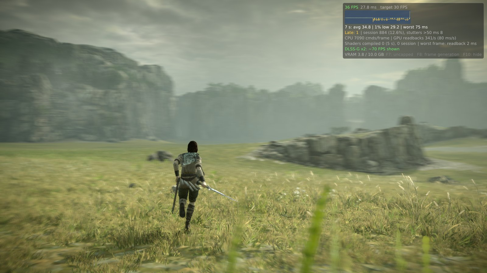
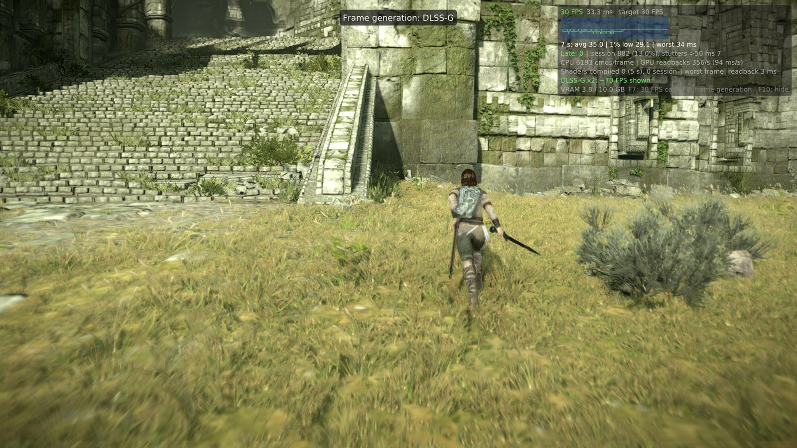
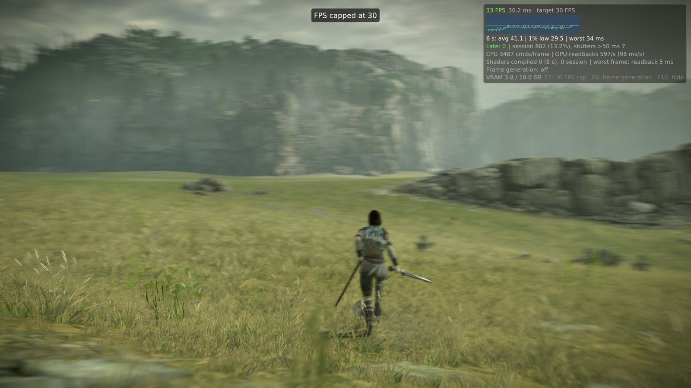

<h1 align="center">Shadow of the Colossus — native PC port, with frame generation</h1>

<p align="center">
  <a href="https://github.com/nakaionyt/ShadowOfTheColossus-PC-FrameGen/releases/latest"></a>
  
  
  
  <a href="LICENSE"></a>
</p>

<p align="center">
  
</p>

The PS4 *Shadow of the Colossus* (Bluepoint, 2018) running natively on Windows: the game's own
x86-64 code runs on your CPU and the PS4 GPU work is translated to Vulkan. It is not a full
emulator. This build adds **frame generation** to the
[Oussama268/ShadowOfTheColossus-PC](https://github.com/Oussama268/ShadowOfTheColossus-PC) port, so
the game's 30 FPS lock is shown at a steady **60 FPS**, and lets you uncap it **live**.

> [!IMPORTANT]
> **Bring your own game files.** No game file and no Sony firmware is included. You need your own
> PS4 dump of the game (**CUSA08809, EU version 1.01**) and, for sound, `libSceNgs2.sprx` and
> `libSceUlt.sprx` from **your own console**.

## Highlights

- **Frame generation:** NVIDIA **DLSS Frame Generation** on RTX 40/50, AMD **FSR 3** on any Vulkan
  1.3 GPU (RTX 20/30, Radeon, Arc). One generated frame between two game frames.
- **F7 caps or uncaps the game at any time:** 30 FPS like the PS4, or as fast as your CPU goes.
- **F8 switches frame generation:** off → DLSS-G → FSR 3, live, no restart.
- **Steady pacing:** 60 frames shown per second with the cap on, one every 16 to 17 ms. A late
  game frame no longer halves the frame rate.
- **Faster:** far sun shadow cascades are reused between frames (+17 to 22% FPS at the shrine).
- **F10 overlay:** frame rate, frame time graph, late frames, frame generation status.

<p align="center">
  
  
</p>

## Performance

Measured on a Ryzen 7 5800X + RTX 4070 SUPER, 2560×1440 output, running through the open world:

| Setting | Game FPS | Shown on screen |
|---|---|---|
| **30 FPS cap + FSR 3** | 30.0 | **60.0**, one frame every 16–17 ms |
| **30 FPS cap + DLSS-G** | 30.0 | **60**, 0.04% late frames |
| Uncapped | 40–60 depending on the area (average 50) | same |
| Uncapped + FSR 3 | 40–50 | 80–113 |

The game logic follows real time: uncapped, Wander runs at the same speed as capped. The port is
**CPU-bound** (one very busy thread): single-core speed matters most, the GPU is lightly used.

| | Capped at 30 | Uncapped (F7) |
|---|---|---|
| **No frame generation** | 30, as on PS4 | 40–60 |
| **Frame generation (F8)** | **60, very even** ← recommended | 80–110, varies by area |

## Quick start

1. Download `SotC-PC_v0.57-fg1_bring-your-own-game-files.zip` from
   [Releases](https://github.com/nakaionyt/ShadowOfTheColossus-PC-FrameGen/releases/latest) and
   unzip it anywhere.
2. Install Microsoft's
   [Visual C++ Redistributable 2015–2022 x64](https://learn.microsoft.com/cpp/windows/latest-supported-vc-redist)
   if it is missing (NVIDIA frame generation needs it).
3. Run `SotC.exe` and choose your game folder (the `CUSA08809` dump with `eboot.bin`) and the
   folder with your sound modules.
4. In **Quick settings**: *Frame generation* → **Automatic** (DLSS-G on RTX 40/50, else FSR 3),
   *Uncapped FPS* → unchecked for a steady 60.
5. **PLAY.** The first minutes can stutter a little while shaders compile (once).

Controller (DualShock 4, DualSense, Xbox…) or keyboard and mouse; keys can be remapped in
the launcher's **Controls** page.

### In-game keys

| Key | Action |
|---|---|
| **F7** | 30 FPS cap on / off |
| **F8** | Frame generation: off → DLSS-G → FSR 3 → off |
| **F10** | Show / hide the FPS overlay |

### Requirements

- Windows 10/11 64-bit, a Vulkan 1.3 GPU with recent drivers.
- **CPU:** a fast single core (Ryzen 5000/7000, Intel 12th gen or newer). Turning on XMP/EXPO in
  the BIOS helps a lot (+25% measured).
- **GPU:** RTX 3060 / 4060 or Radeon RX 6600 are enough. DLSS-G needs an RTX 40 or 50 and Windows
  *Hardware-accelerated GPU scheduling*. About 4 GB of video memory at 1440p.
- For a steady 60: a 60 or 120 Hz display, or G-SYNC / FreeSync.

## Is the whole game playable?

The game is playable: menus, saves, the open world, sound, controller, keyboard and mouse. A full
run from start to end with all 16 colossi has **not** been verified on this exact build yet.

Known issues:

- Switching saves without restarting the game can close it: restart before loading another save.
- In places the water stays dark or flat.
- FSR 3 was tested on an NVIDIA card; on AMD and Intel it is less tested. Feedback welcome in
  [Issues](https://github.com/nakaionyt/ShadowOfTheColossus-PC-FrameGen/issues).
- FSR 3 is a little less clean than DLSS-G when the camera turns fast (slight ghosting).

If anything looks wrong: press **F8** until frame generation is *off*, or set it to *Off* in the
launcher.

## Under the hood

- **Frame generation inputs** come from the game itself: depth and motion vectors are copied from
  its G-buffer pass (an R16G16 float target holding `curUV − prevUV`), and the camera (view and
  projection, jitter, near/far, reversed-Z) is decoded from its view constants.
  [`vk_dlssg.cpp`](gpu/shadps4/video_core/renderer_vulkan/vk_dlssg.cpp)
- **DLSS-G** goes through NVIDIA Streamline 2.14 (Vulkan), with Reflex markers.
- **FSR 3** uses the FidelityFX SDK 2.3 optical flow and frame interpolation on Vulkan
  ([FSR-Vulkan](https://github.com/FireBurn/FSR-Vulkan)). The presenter shows the interpolated frame,
  then the game frame half a frame later.
  [`vk_fsrfg.cpp`](gpu/shadps4/video_core/renderer_vulkan/vk_fsrfg.cpp)
- **F7:** the game caps itself with `sceVideoOutSetFlipRate(1)` and its logic follows real time;
  the rate it asks for is kept and applied or not by the vblank thread.
  [`sotc_fps_cap.h`](gpu/shadps4/video_core/sotc_fps_cap.h)
- **Shadow reuse:** the engine snaps its sun shadow cascades to texels, so a far cascade is moved
  by whole texels instead of redrawn every other frame (99.9% texel-identical to a real draw).
  [`vk_shadow_scroll.cpp`](gpu/shadps4/video_core/renderer_vulkan/vk_shadow_scroll.cpp)

## Building

Windows with [MSYS2](https://www.msys2.org/) (CLANG64); package list in
[packaging/windows/README.md](packaging/windows/README.md). Freezing `SotC.exe` needs a Windows
Python with PyInstaller and Pillow (`WINPYTHON`).

```bash
git clone --recursive https://github.com/nakaionyt/ShadowOfTheColossus-PC-FrameGen.git
bash build.sh                              # out/bb-probe.exe
bash packaging/windows/package_sotc.sh     # dist/SotC-PC.zip
```

The release zip also carries the NVIDIA Streamline 2.14.16 runtime files next to `bb-probe.exe`
(`sl.interposer.dll`, `sl.common.dll`, `sl.dlss_g.dll`, `sl.reflex.dll`, `sl.pcl.dll`,
`nvngx_dlssg.dll`, `NvLowLatencyVk.dll`, from the
[official SDK](https://github.com/NVIDIA-RTX/Streamline/releases/tag/v2.14.16)). Packaging refuses
any `.sprx`/`.prx`: Sony firmware never goes into the package. More details on the port, its
launcher and its diagnostic variables: [docs/README-upstream.md](docs/README-upstream.md) and
[docs/sotc/README-SotC.md](docs/sotc/README-SotC.md).

## Credits

- [AjncSystem](https://github.com/AjncSystem/ShadowOfTheColossus-PC): the Shadow of the Colossus
  PC port; [Oussama268](https://github.com/Oussama268/ShadowOfTheColossus-PC): the 0.57-opt
  fork this build starts from.
- [bloodborne_pc](https://github.com/Supermedo/bloodborne_pc) (Supermedo, deadinside, deadinside28):
  native loader, runtime and launcher.
- [shadPS4](https://github.com/shadps4-emu/shadPS4) and the shadPS4 SotC fork: Vulkan video core.
- [Pink-shadPS4](https://github.com/luizgustavs/Pink-shadPS4) (luizgustavs): culling, command
  recording thread, shader fixes and more.
- illusion: the original 60 FPS patch (GoldHEN).
- AMD FidelityFX FSR 3, ported to Vulkan by [FSR-Vulkan](https://github.com/FireBurn/FSR-Vulkan).
- NVIDIA DLSS Frame Generation, Streamline and Reflex.

## Legal

*Shadow of the Colossus* belongs to Sony Interactive Entertainment; the 2018 remake is by Bluepoint
Games. This project is not affiliated with Sony, Bluepoint, NVIDIA or AMD, and contains no game
data. NVIDIA, DLSS and Reflex are trademarks of NVIDIA Corporation; AMD and FidelityFX are
trademarks of Advanced Micro Devices, Inc.

The program is licensed **GPL-2.0-or-later** ([LICENSE](LICENSE)). The NVIDIA runtime files in the
release are under NVIDIA's licenses (`bin/licenses-nvidia/` in the zip); other components are
listed in `THIRD-PARTY-NOTICES.txt`.
